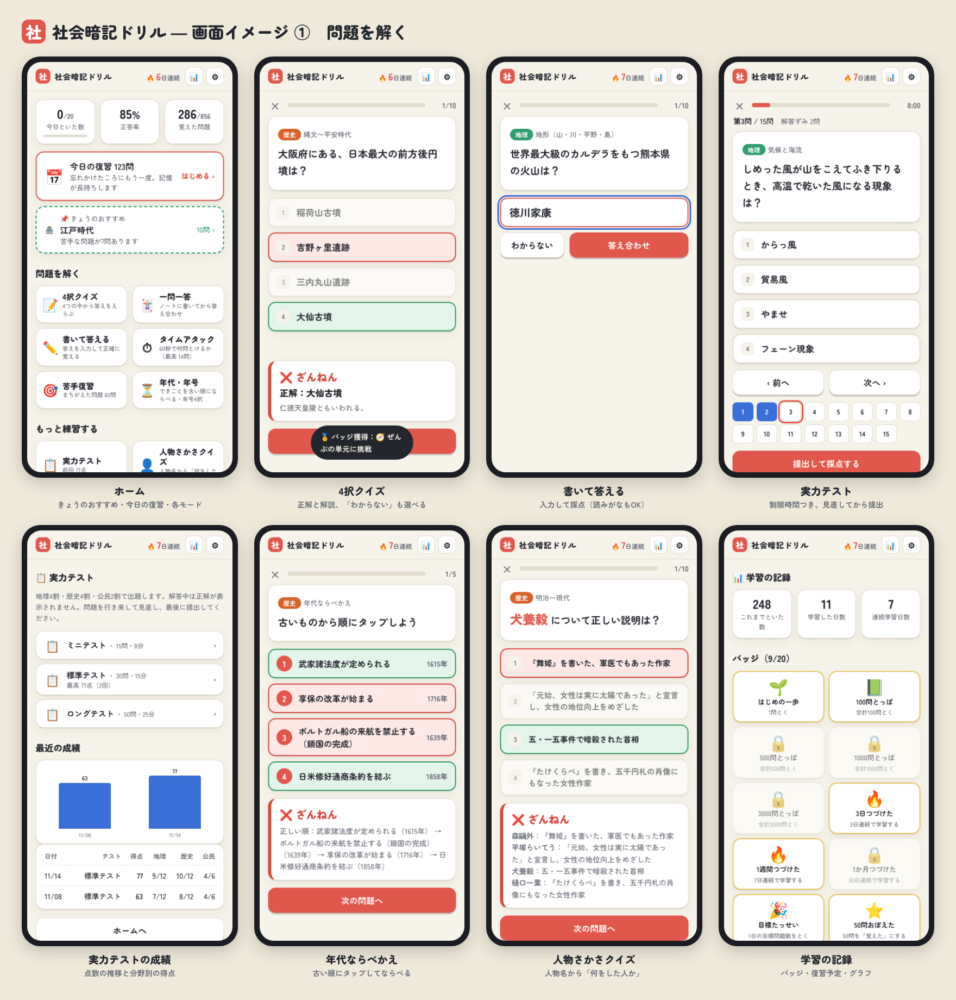
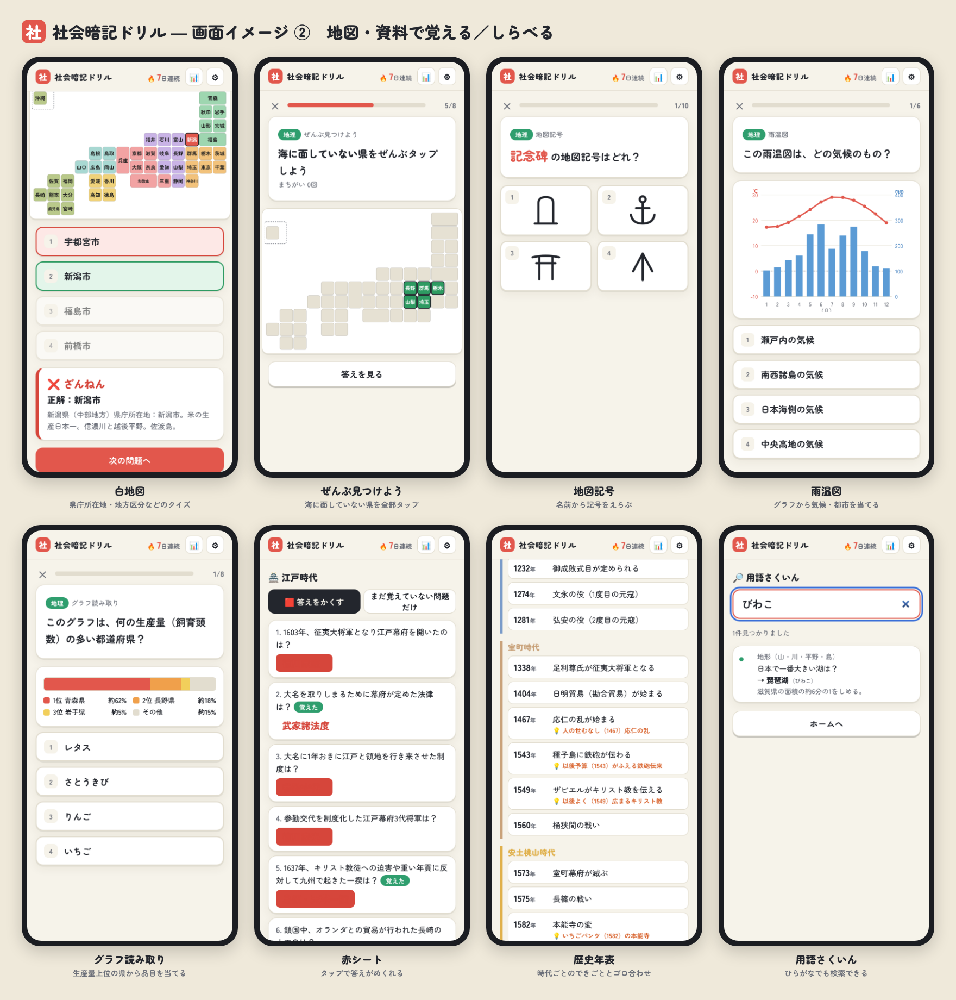
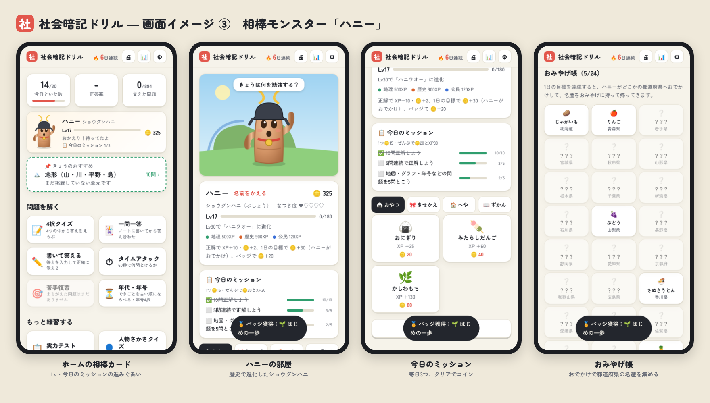
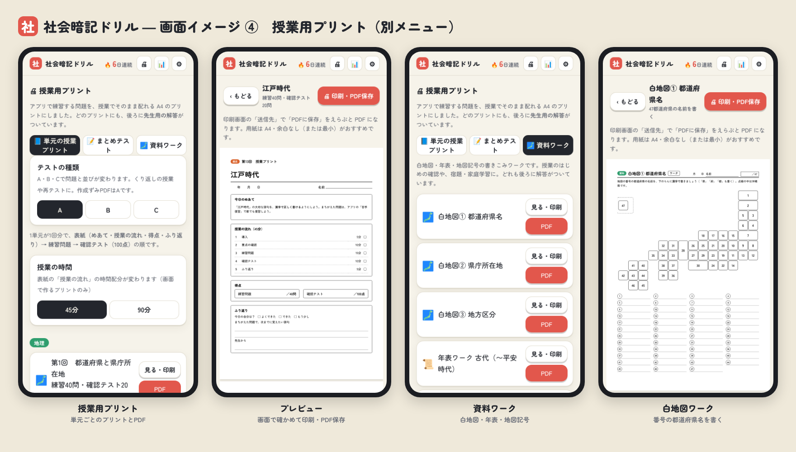

# 武将英語 ― 天下統一の英語道

戦国武将のカードを集めて育てる、大人のための英語学習アプリです。
英語の問題に正解するたびに出陣中の武将が経験値を得てレベルアップし、貯めた小判で新たな武将を召喚（ガチャ）できます。

## 遊び方
- **召喚**：小判で武将カードを引く（1回100枚／10連900枚・SR以上1枚確定、80回でUR確定）
- **合戦**：10問の英語クイズ。正解で敵軍を討ち、連撃（コンボ）で経験値ボーナス
  - 出題形式：英→和／和→英／例文の穴埋め／リスニング（ブラウザの音声読み上げ）
  - 分野：ビジネス英単語・イディオム・句動詞・大人の言い回し（各30語）＋間違えた語の「雪辱戦」
- **武将帳**：全26武将（UR / SSR / SR / R）。同じ武将が出たら「限界突破」でレベル上限+5
- **特技**：武将ごとに 経験値UP・小判UP・連撃強化・ミス無効・誤答消去 の効果
- **単語帳**：習熟度（3連続正解で習得）と苦手語の一覧、発音再生
- 毎日のログインボーナス、進捗はブラウザ（localStorage）に自動保存

## 起動
ビルド不要です。`index.html` をブラウザで開くか、静的サーバーで配信してください。

```sh
python3 -m http.server 8000   # → http://localhost:8000
```

## 構成
| ファイル | 内容 |
| --- | --- |
| `js/portraits.js` | 武将イラストを SVG で描画するエンジン（兜・前立・甲冑・家紋・顔・背景を重ね描き） |
| `js/warlords.js` | 武将データ（意匠・能力・特技・名言） |
| `js/vocab.js` | 学習データ（120語・例文・和訳） |
| `js/app.js` | ゲーム本体（合戦・成長・召喚・図鑑・単語帳） |
| `css/style.css` | 和風UI・カードの枠演出 |

---

# 社会暗記ドリル ― 中学受験（`shakai/`）

中学受験の社会（地理・歴史・公民）の暗記分野を演習するアプリです。ビルド不要で、`shakai/index.html` をブラウザで開くだけで使えます。
Webサーバーで配信すると、スマホやタブレットのホーム画面に追加してオフラインでも使えます（PWA）。

```sh
cd shakai && python3 -m http.server 8000   # → http://localhost:8000
```

## 画面イメージ





## 問題を解く
| モード | 内容 |
| --- | --- |
| 4択クイズ | 単元・問題数・「まだ覚えていない問題だけ」を選んで出題。誤答は同じ単元の語句を優先してまぎらわしく。「わからない」も選べる。解答ごとに正解と解説を表示 |
| 一問一答 | ノートに漢字で書いてから答えを見て、⭕/❌を自分で記録 |
| 書いて答える | 答えを入力して採点。「青森」→「青森県」のような省略や全角・半角のゆれは正解扱い。変換ミスなどは自分で正解にできる |
| タイムアタック | 60秒で何問正解できるか。自己ベストを記録 |
| 苦手復習 | まちがえた問題だけを出題 |
| 今日の復習 | 正解した問題を1日後・3日後・1週間後・2週間後・1か月後に出し直す（間隔反復） |
| 年代・年号 | できごと4つを古い順にならべる／年号の4択。時代（古代・中世・近世・近現代）を選べる |

## もっと練習する
| モード | 内容 |
| --- | --- |
| 実力テスト | 本番形式の模擬テスト（15・30・50問、制限時間つき）。地理4割・歴史4割・公民2割。約2割は白地図・年号・地図記号・雨温図の資料問題。見直してから提出し、100点満点で採点。分野別の得点・前回との比較・成績の推移グラフ |
| 人物さかさクイズ | 人物名を見て「何をした人か」の説明をえらぶ（時代別） |

## 地図・資料で覚える
| モード | 内容 |
| --- | --- |
| 白地図 | 47都道府県のタイル地図。場所をタップ・県名・県庁所在地・地方区分のクイズ、「海に面していない県」などを地図でぜんぶ見つけるチャレンジ、県をタップして特色を調べる地図 |
| 地図記号 | 24種の地図記号をSVGで表示。記号→名前・名前→記号のクイズと一覧（由来つき） |
| 雨温図 | 6つの気候区分の代表都市（札幌・金沢・東京・松本・高松・那覇）の雨温図から、気候・都市を当てる |
| グラフ読み取り | 生産量（飼育頭数）の多い都道府県と割合の帯グラフから、品目を当てる（農林水産省の統計2023〜2024年の概数） |

## しらべる
| モード | 内容 |
| --- | --- |
| 赤シート | 単元の問題と答えを一覧で読み、答えを赤いシートでかくして覚える |
| 歴史年表 | 時代ごとのできごとと年号のゴロ合わせ。年号をかくして思い出す練習も |
| 用語さくいん | 語句から問題・答え・解説・年表・都道府県を検索（ひらがな・読みでも探せる） |

## 相棒モンスター「ハニー」
問題をとくと XP とコインがもらえ、はにわのモンスター「ハニー」が育ちます（ホームのカードをタップするとお世話できます）。
- タマゴ → ちびハニ（Lv2）→ ハニまる（Lv5）→ **Lv15 でいちばん勉強した分野で進化**（地理：タビハニ／歴史：ショウグンハニ／公民：ギチョウハニ）→ ハニワオー（Lv30）→ コフンノカミ（Lv50）
- 正解で XP+10・🪙+2、1日の目標達成で 🪙+30、バッジで 🪙+20、レベルアップで 🪙+10
- コインで おやつ（XPアップ）・きせかえ（あたま・かお・くび）・へや（5種類）を買える。図鑑で姿を集める
- 連続正解やまちがいが続いたときに声をかけてくれる。夜は寝ている。タップすると反応する
- **今日のミッション**：毎日3つ（例：10問正解・5問連続正解・地図やグラフの問題を5問）。1つで 🪙+15、全部で 🪙+20・XP+30
- **おみやげ**：1日の目標を達成するとハニーがどこかの都道府県へおでかけし、名産を持って帰る（おみやげ帳に24都道府県）
- 記録はユーザーごとに別々

## 授業用プリント（🖨 ボタン）
問題を解く画面とは別のメニューです。アプリで練習する問題を、授業でそのまま配れる A4 のプリントにしました。
- 1単元が1回分（全21回）：**表紙**（今日のめあて・授業の流れ・得点らん・ふり返り）→ **練習問題**（最大40問）→ **確認テスト**（20問・100点）→ **先生用の解答**（切りはなせる）
- 「PDF」で作成ずみのファイル（`shakai/print/授業プリント/`）をダウンロード、「見る・印刷」で画面で確かめてから印刷・PDF保存
- 授業時間 45分／90分 で表紙の時間配分が変わる。アプリでまちがえた問題だけのプリントも作れる
- 確認テストは **A・B・C の3種類**（問題と並びが変わる）。くり返しの授業や再テストに
- **資料ワーク**：白地図（都道府県名・県庁所在地・地方区分の色分け）、年表（時代別4枚・年を書く）、地図記号の書きこみワーク。作成ずみ PDF は `shakai/print/資料ワーク/`
- **まとめテスト**：地理・歴史・公民（各25問・1問4点）と総合テスト（50問・1問2点）。作成ずみ PDF は `shakai/print/まとめテスト/`
- 問題データを変えたら `npm run print` で全部の PDF を作り直せる（Playwright が必要。`node tools/make-lesson.js h3` で1単元だけ、`npm run print:tests` でまとめテストだけ、`npm run print:works` で資料ワークだけ）

## 記録・その他
- 同じ問題に2回連続で正解すると「覚えた」。単元ごとの習得率をホームに表示
- ホームの「きょうのおすすめ」：苦手が多い単元・まだ挑戦していない単元などを10問すすめる
- 読みにくい答え（約200語）に読みがなを表示。「書いて答える」ではひらがなでも正解（漢字で書くよう声かけ）
- 📊 記録：これから7日間の復習予定・最近2週間の解答数・単元別の正答率・よくまちがえる問題・20種類の達成バッジ（保護者向けに印刷も可）
- 📄 プリント：苦手な問題や単元ごとの問題用紙＋解答をA4で印刷
- ⚙ 設定：ユーザーの切りかえ（きょうだいで記録を分けられる）、効果音・文字サイズ・1日の目標問題数、学習記録の書き出し／読みこみ
- 記録はブラウザ（localStorage）に保存されます

## 収録範囲（21単元・895問＋年代のできごと69件）
| 分野 | 単元 |
| --- | --- |
| 地理 | 都道府県と県庁所在地／地形（山・川・平野・島）／気候と海流／農業・水産業／工業・伝統工芸・公害／世界の中の日本／日本の世界遺産／地形図と地図記号／地方ごとの特色／交通・人口・防災 |
| 歴史 | 縄文〜平安／鎌倉〜安土桃山／江戸／明治〜現代／戦後の日本／史料・名言と時代 |
| 公民 | 日本国憲法と人権／国会・内閣・裁判所／経済・国際社会／社会保障とくらし／選挙と行政のしくみ |

生産量の順位などの統計は、年によって入れかわることがある項目をなるべく避け、2024年の統計にもとづいて確認しています。最新の資料もあわせて確認してください。

## 構成
| ファイル | 内容 |
| --- | --- |
| `js/data.js` | 問題データ（単元・問題・誤答候補・年代のできごと・ゴロ合わせ） |
| `js/readings.js` | 読みにくい答えの読みがな |
| `js/app.js` | アプリ本体（各モード・記録・設定・プリント・ユーザー・バッジ） |
| `js/graphs.js` | グラフ読み取り（生産量の多い都道府県の割合） |
| `js/monster.js` | 相棒モンスター（育成・ショップ・図鑑・声かけ） |
| `js/lesson.js` / `js/works.js` / `js/prints.js` | 授業プリント・テストの組み立て／資料ワーク／授業用プリントのメニュー |
| `tools/make-lesson.js` | 授業プリントの PDF を一括作成 |
| `js/exam.js` | 実力テスト |
| `js/persons.js` | 人物さかさクイズ |
| `js/notes.js` | 赤シート |
| `js/timeline.js` | 歴史年表 |
| `js/search.js` | 用語さくいん |
| `js/map.js` | 白地図（都道府県のマス目の位置・県庁所在地・特色） |
| `js/symbols.js` | 地図記号（SVG）と由来 |
| `js/climate.js` | 雨温図（気象庁の平年値1991〜2020年をもとにした概数） |
| `sw.js` / `manifest.webmanifest` | オフライン対応・ホーム画面への追加 |
| `tests/` | データの整合性テストと画面の通しテスト |

## 問題の追加
`js/data.js` の各単元の `items` の**最後に** `Q(問題, 答え, 選択肢グループ, 解説, [誤答])` を追加します（問題IDは並び順から作られるため、途中に追加すると学習記録がずれます）。
4択の誤答は同じグループの他の答えから自動で選ばれます。まぎらわしい問題は5番目の引数で誤答を直接指定してください。

追加したらテストを実行します。

```sh
cd shakai
npm test            # 問題データの整合性（誤答が3つ以上あるか、まぎらわしい誤答がないか、読みがなの見出しなど）
npm run test:e2e    # 全モードの画面テスト（Playwright が必要）
```

ファイルを変更して公開するときは、`sw.js` の `CACHE` の番号を上げてください。
